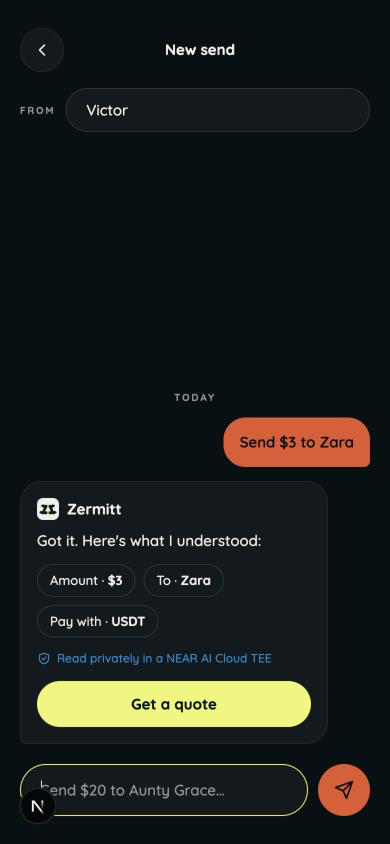
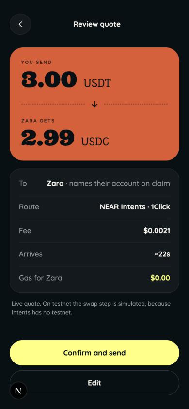
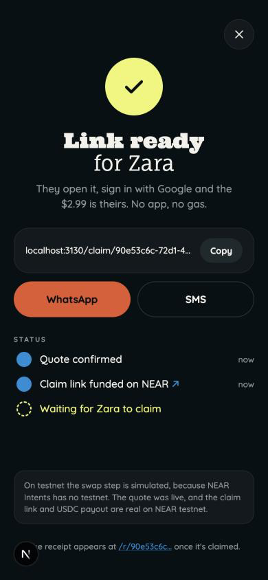
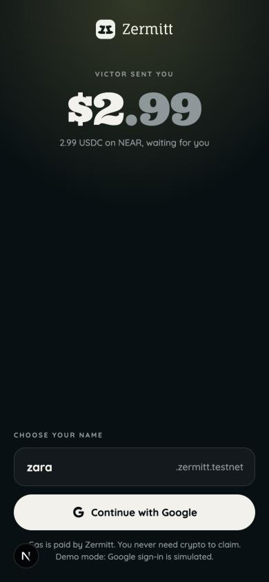
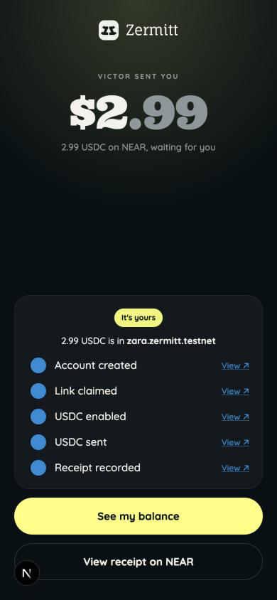
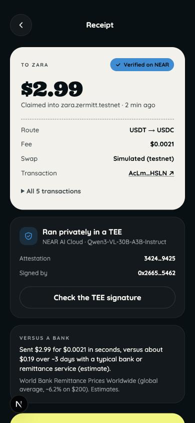
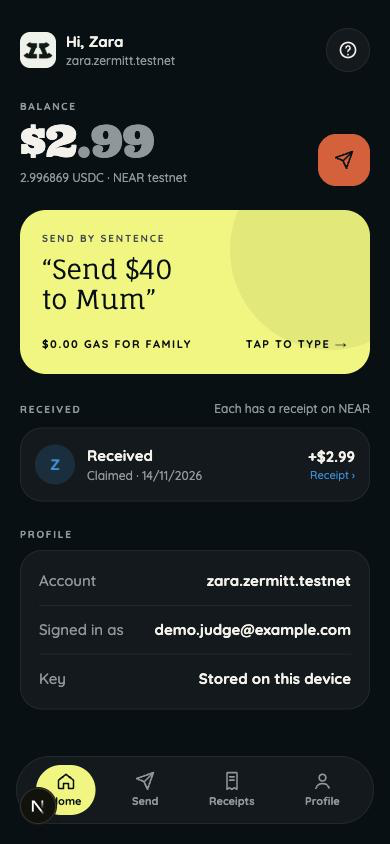

# Zermitt

The home page is a seven-section product story built in the **Calabash** design system. The app screens (`/wallet`, `/send`, `/claim`, `/r`) use a dark phone UI built from the approved designs in `docs/design/app/`. See the [landing-page claim audit](docs/LANDING_CLAIMS.md), [image credits](docs/IMAGE_CREDITS.md), [landing screenshots](docs/screenshots/) and [app screenshots at 390px](docs/screenshots/app/).

**Send money home with one sentence.** Type "send $50 to mum". Zermitt quotes
the route into USDC on NEAR through NEAR Intents and sends a claim link. Mum
signs in with Google, picks a name like `mama.zermitt.testnet`, and gets the
dollars without a wallet, gas or crypto words. Every transfer gets a public
receipt on NEAR that anyone can verify.

**Hackathon tracks:** Payments & Remittances · Privacy & Private AI

> **Status:** the full flow runs on NEAR **testnet**: sentence → live quote →
> claim link → Google sign-in → named account → USDC payout → on-chain
> receipt. NEAR Intents has no testnet, so in demo mode the currency swap is
> **simulated and labeled as such**. The quote itself is real mainnet pricing.

## The problem

Sending $200 home costs about **6.2% on average** and often takes days
(World Bank, *Remittance Prices Worldwide*). Crypto rails are cheaper and
faster, but they expect both people to manage wallets, seed phrases and gas.
The person receiving is usually the one least able to.

## The solution

- **Sender:** types a sentence. An AI agent parses it, privately inside a TEE
  when NEAR AI Cloud is configured. The app shows a live NEAR Intents quote
  (amount, fee, rate, time) before anything is sent.
- **Recipient:** opens a link, signs in with Google, chooses a name, and
  receives USDC in a named NEAR account. They never sign a transaction or
  hold NEAR. Zermitt's relayer pays every fee.
- **Everyone:** gets a receipt on NEAR whose hash can be recomputed in the
  browser or from the command line, with no keys.

## Demo

> 🎬 **Demo video:** _placeholder for the 75-second recording (`docs/demo.gif`)._

Demo transfers on testnet, both claimed, with receipts on NEAR:

| Transfer | Recipient account | Receipt |
| --- | --- | --- |
| Victor → mum, $25 | `mama.zermitt.testnet` | `/r/0153b43a-c452-4c4e-8d3b-8c7e2ef8101b` |
| Victor → tunde, $40 | `tunde.zermitt.testnet` | `/r/2b9f5291-5ed5-40a8-9823-acb6e7611cbf` |

Both parses ran in NEAR AI Cloud's TEE, and their signature bundles are
committed, so the receipts and TEE proofs verify on a fresh clone (see
[How to verify](#how-to-verify)).

### Screens

A real testnet send to Zara, captured at 390px:

| 1. Type it | 2. Review the quote | 3. Share the link |
| :---: | :---: | :---: |
|  |  |  |
| **4. Claim with Google** | **5. Claimed** | **6. Receipt on NEAR** |
|  |  |  |
| **Home** | | |
|  | | |

Other states: [empty home](docs/screenshots/app/wallet-empty-390.png) ·
[already claimed](docs/screenshots/app/claim-already-claimed-390.png) ·
[invalid link](docs/screenshots/app/claim-invalid-390.png) ·
[receipt waiting for claim](docs/screenshots/app/receipt-pending-390.png) ·
[receipt with the standard agent](docs/screenshots/app/receipt-standard-agent-390.png).

## Architecture

```
 Browser (Next.js, mobile-first)              Server (Next.js API routes)
 ───────────────────────────────              ─────────────────────────────────────
 /send  "send $25 to mum" ───────────────────▶ agent: parse sentence
                                                ├─ NEAR AI Cloud (TEE) + attestation   [NEARAI_API_KEY]
                                                ├─ Anthropic                           [ANTHROPIC_API_KEY]
                                                └─ deterministic parser                [no keys]
                          ◀── quote card ───── 1Click dry quote (NEAR Intents, mainnet pricing)
        Confirm ─────────────────────────────▶ swap: simulated in demo mode │ LIVE_INTENTS: real 1Click swap
                                                fund claim link: NEP-452 linkdrop on `testnet` (relayer pays)
                          ◀── claim link ─────
 /claim/<id>#k=<claimKey>
   Google sign-in (Privy) or demo login
   ed25519 key generated in the browser
   name + PUBLIC key ────────────────────────▶ 1. create name.zermitt.testnet (relayer pays)
                                                2. linkdrop `claim` → NEAR to new account
                                                3. storage_deposit on usdc.fakes.testnet (relayer pays)
                                                4. ft_transfer USDC → new account (relayer pays)
                                                5. record_receipt on receipts-v2.zermitt.testnet
 /wallet  balance + history                     data/transfers.json (local record)
 /r/<id>  receipt read FROM THE CONTRACT, hash verified in the browser
```

The recipient signs **no** on-chain transactions, so no NEP-366
meta-transaction is needed. Steps 1 and 3–5 are signed by the relayer
(`zermitt.testnet`) and step 2 by the one-time linkdrop claim key. The
browser-generated private key never leaves the browser. The relayer creates
the sub-account itself because the `testnet` linkdrop contract can only
create direct children of `testnet`.

Key code: `lib/agent/` (parsing, TEE proof) · `lib/intents/` (1Click) ·
`lib/send/` and `lib/claim/` (on-chain steps) · `lib/receipts/` (canonical
hash, TEE check) · `contracts/receipts/` (Rust contract, wasm committed).

## Features

| Feature | Status |
| --- | --- |
| Chat-to-send ("send $50 to mum") | ✅ NEAR AI Cloud (TEE) with `NEARAI_API_KEY`, Anthropic with `ANTHROPIC_API_KEY`, deterministic parser with no keys |
| Routing via NEAR Intents | ✅ live 1Click quotes for USDT or NEAR (on NEAR) → USDC · 🧪 swap execution simulated in demo mode · `LIVE_INTENTS` mainnet swap implemented but not yet exercised · other assets and chains: 🗺️ |
| Quote and confirm before sending | ✅ amount in and out, fee and arrival time shown before confirming |
| Claim links | ✅ funded and claimed on testnet; shareable via WhatsApp/SMS |
| Google sign-in | ✅ Privy, identity only, when `DEMO_MODE=false` and `NEXT_PUBLIC_PRIVY_APP_ID` are set; simulated in demo mode so judges need no account |
| Named sub-accounts (`mama.zermitt.testnet`) | ✅ recipient picks a name; validated and checked for availability |
| Gasless claims | ✅ recipient signs nothing on-chain; the relayer pays every step |
| Dollar balance | ✅ `/wallet`: live USDC balance for the account on this device and its received transfers, each linking to its receipt |
| Receipt page | ✅ `/r/[id]` reads from the contract and verifies the hash in the browser |
| On-chain receipt contract | ✅ `receipts-v2.zermitt.testnet` (v1 `receipts.zermitt.testnet` still read); Rust + near-sdk, wasm committed |
| Fee comparison | ✅ shown on receipts; figures are estimates, source cited below |
| Private agent (NEAR AI Cloud attestation) | ✅ parse runs in a TEE; signature, nonce and report hash checked against the receipt. Raw TDX/NVIDIA quotes are not verified here |

## How to verify

### 1. Fresh clone, no `.env` (no keys needed)

```bash
pnpm install
pnpm test                 # 44 tests
pnpm build
pnpm dev                  # open the printed URL (usually http://localhost:3000)
pnpm demo:e2e             # keyless run: parse + live quote, skips on-chain
                          # send/claim, verifies a committed receipt on-chain
pnpm verify:receipt 0153b43a-c452-4c4e-8d3b-8c7e2ef8101b   # Victor → mum
pnpm verify:receipt 2b9f5291-5ed5-40a8-9823-acb6e7611cbf   # Victor → tunde
```

Expected `verify:receipt` output (abridged):

```
✅ Verified — the on-chain data matches its hash.

🔒 Private agent: model Qwen/Qwen3-VL-30B-A3B-Instruct, TEE signing key 0x2665cce942fa427ef30d87f4b0bff67fb7645462
   TEE bundle source: fixtures/tee/2b9f5291-5ed5-40a8-9823-acb6e7611cbf.json
   ✅ signature recovers to signing key
   ✅ request/response hashes match signed text
   ✅ attestation bound to request nonce
   ✅ sha256(report) = on-chain attestation_hash
   ✅ signing key and model = on-chain fields
✅ TEE proof verified (raw TDX/NVIDIA quotes not checked — needs vendor attestation services).
```

In the browser, open `/r/2b9f5291-5ed5-40a8-9823-acb6e7611cbf` and press
**Verify in this browser** and **Check response signature**. In demo mode
you can also go to `/send` and get a live quote with no keys. Confirming a
send needs a funded relayer (next section).

Contract tests (optional, needs Rust): `cd contracts/receipts && cargo test`
(5 tests).

### 2. Full on-chain run (needs a funded testnet relayer)

```bash
cp .env.example .env      # set RELAYER_ACCOUNT_ID / RELAYER_PRIVATE_KEY
pnpm demo:e2e             # parse → quote → (simulated swap) → claim link →
                          # named account → gasless claim → USDC → receipt
```

The relayer must own the parent account for the names: sub-accounts of
`zermitt.testnet` can only be created with its key. With your own testnet
account, set `ZERMITT_PARENT=<your account>` and fund it with test USDC
(`usdc.fakes.testnet` has a public `mint`). Receipts can only be recorded
by the receipts contract's owner, so a different relayer's claims still
complete but skip the receipt. Deploy your own copy from
`contracts/receipts/res/zermitt_receipts.wasm` and set `RECEIPTS_CONTRACT`
and `NEXT_PUBLIC_RECEIPTS_CONTRACT` to record them.

In the browser: `/send` → type "Send $5 to Mum" → **Get a quote** → **Confirm and
send** → open the claim link → pick a name → **Continue with Google** (the claim
starts after sign-in and takes about a minute) → `/wallet` → receipt.

### Receipts

Each claimed transfer is recorded with a sha256 hash over the canonical JSON
(sorted keys) of exactly the metadata stored on-chain, so it can be
recomputed from the contract alone. v2 adds optional private-agent fields.
Absent fields are left out of the hash, so v1 receipts still verify. v2 was
deployed fresh instead of migrating v1, so old receipts stay immutable.

Fee comparison: estimates from `lib/receipts/comparison.ts`, based on the
World Bank's [Remittance Prices Worldwide](https://remittanceprices.worldbank.org)
global average (~6.2% to send $200) and typical 1–5 business-day bank
settlement.

### Private agent (NEAR AI Cloud)

With `NEARAI_API_KEY`, parsing runs on NEAR AI Cloud's TEE-hosted
**`Qwen/Qwen3-VL-30B-A3B-Instruct`**, capped at 100 output tokens. It is the
cheapest model per parse (about $0.00003) whose `/v1/attestation/report`
returns Intel TDX + NVIDIA evidence bound to a signing address. Proxied
models (OpenAI, Anthropic, Google, OpenRouter-routed) return 503 from that
endpoint. `z-ai/glm-5.3-flash` lists cheaper, but it always reasons first,
which costs more per parse and cut off about 1 answer in 5 at the cap.

Per request the app keeps the model ID, the ECDSA signature over
`sha256(request):sha256(response)`, and a fresh attestation report
(random 32-byte nonce). It commits `agent_provider`, `model`,
`attestation_hash` (sha256 of the report) and `signing_key` to the receipt.
**Verified:** the signature recovers to the attested signing key, the
request and response hashes match, the attestation echoes the nonce, and
the report hash and key match the receipt. **Not verified:** the raw Intel
TDX / NVIDIA quotes, which need vendor attestation services (see
[nearai/nearai-cloud-verifier](https://github.com/nearai/nearai-cloud-verifier)).
Signature bundles live with the instance that made the transfer. The demo
receipts' bundles are committed in `fixtures/tee/`.

### LIVE_INTENTS

Off by default. Setting `LIVE_INTENTS=true` with `MAINNET_ACCOUNT_ID` /
`MAINNET_PRIVATE_KEY` (a mainnet account holding a little USDT, capped at 2
USDT per swap) makes the send step request a non-dry 1Click quote, deposit
to it and poll its status. This path is implemented but **has not been run
against mainnet yet**.

## How NEAR is used

- **NEAR Intents (1Click API):** live quotes for the route into USDC on NEAR,
  shown before every send. Execution is simulated on testnet, with a mainnet
  path behind `LIVE_INTENTS`.
- **Linkdrops (NEP-452):** each send funds a claim key on the `testnet`
  linkdrop contract. The private key is the claim link.
- **Named accounts:** recipients get `name.zermitt.testnet`, created by the
  relayer with the recipient's browser-generated key as the full-access key.
- **Relayer-paid transactions:** the recipient never needs NEAR. Account
  creation, storage deposit and the USDC transfer are paid by `zermitt.testnet`.
- **NEP-141 token:** payouts in test USDC (`usdc.fakes.testnet`, 6 decimals).
- **Smart contract:** `receipts-v2.zermitt.testnet`, a Rust/near-sdk
  contract with owner-only `record_receipt`, duplicate rejection and paged
  reads. The wasm is committed.
- **NEAR AI Cloud:** private, attested parsing in a TEE, with the proof
  committed to the receipt.

## Judging criteria

- **Technical:** five on-chain steps per claim, all relayer-paid. A custom
  Rust contract with unit tests. Receipts that verify from the chain alone.
  TEE attestation checked and bound to each receipt. 44 TypeScript tests,
  and a fresh clone runs with no keys.
- **Design:** a dark, mobile-first phone UI (centred 430px column on desktop)
  built around the recipient: a large amount and the sender's name, one
  button to claim, plain language ("Gas is paid by Zermitt"), honest testnet
  labels, and loading, error, empty, pending and already-claimed states.
  Inline SVG icons, labelled inputs, visible focus rings, reduced-motion support.
- **Impact:** remittances are a large global market with roughly 6% average
  fees. Zermitt targets the receiver who has never used crypto: a Google
  login is the whole onboarding.
- **Originality:** combines sentence-to-send, an AI agent running in a TEE
  with attestation on every receipt, and claim links into named accounts.
- **Sustainability / business model (planned, not built):** a small spread
  on each Intents route, well under the ~6% incumbents charge, would fund
  the relayer's fees. Later revenue: cash-out partners, a virtual card, and
  yield on idle balances.

## Known issues

- **Swap simulated on testnet:** NEAR Intents has no testnet. Quotes are
  real, execution is simulated in demo mode, and `LIVE_INTENTS` hasn't been
  run on mainnet yet.
- **Routing scope:** quotes cover USDT or NEAR on NEAR → USDC. Other assets
  and chains aren't wired in.
- **Claims take about a minute:** five sequential transactions run inside
  one request.
- **Key custody:** the recipient's NEAR key lives in browser localStorage,
  with no recovery yet (on the roadmap).
- **Running with your own relayer:** see How to verify §2 (`ZERMITT_PARENT`,
  your own receipts contract).
- **TEE:** raw TDX/NVIDIA quotes are not verified locally.
- **Test money:** payouts use `usdc.fakes.testnet`, a public test token.

## Roadmap

- Key recovery through social login
- More assets and chains via NEAR Intents; live swaps by default on mainnet
- Cash-out partners
- Virtual card
- Yield on idle balances
- Recurring sends
- Spending rules

## Background

Phase 0 spikes and findings are in `scripts/spikes/` (`pnpm spike:intents`
needs no keys; `pnpm spike:claim` needs `RELAYER_*`). Social-login research
and the Privy build fix: [scripts/spikes/02-social-login.md](scripts/spikes/02-social-login.md).
